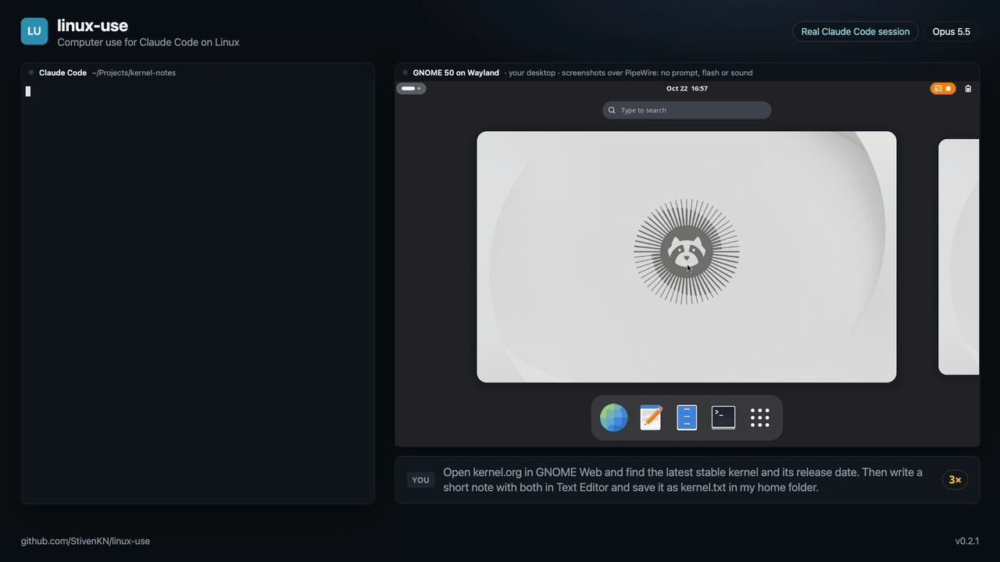
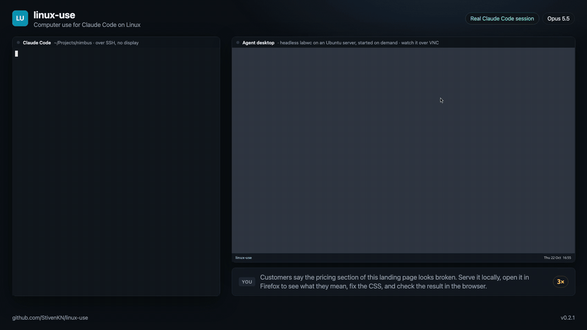
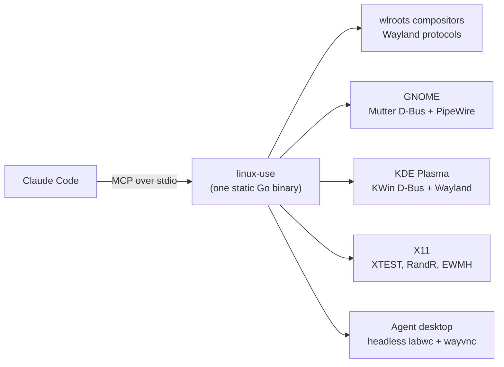

# linux-use

[](https://github.com/StivenKN/linux-use/releases/latest)
[](https://github.com/StivenKN/linux-use/actions/workflows/ci.yml)
[](LICENSE)

**Computer use for Claude Code on Linux.** Claude takes screenshots and drives the mouse, keyboard, apps, windows and clipboard of a Linux desktop, on Wayland or X11. On a server with no screen, it gets a private headless desktop with a real browser that you can watch and take over through VNC.



<sub>A real Claude Code session on GNOME 50, sped up while Claude thinks. [Download the 1080p MP4](https://github.com/StivenKN/linux-use/raw/main/assets/demo-gnome.mp4).</sub>

Claude Code's built-in computer use is macOS-only. linux-use is a community plugin that brings the same tool surface to Linux. It isn't a fork or a patched Claude Code: it installs into your normal `claude` like any other plugin, and Claude uses it the way it uses computer use on a Mac.

## Install

```text
/plugin marketplace add StivenKN/linux-use
/plugin install linux-use@linux-use
/linux-use:setup
```

`/linux-use:setup` checks the machine, offers to install anything missing, and offers to stop Claude Code from asking permission on every click. Restart Claude Code so it loads the tools, then ask for something visual:

> Open Firefox, find the cheapest flight from Bogotá to Lisbon next Friday on Google Flights, and screenshot the result.

The plugin ships a small launcher. On first use, it downloads one static binary (about 10 MB, amd64 or arm64), verifies its SHA-256, and caches it in `~/.cache/linux-use`. There is nothing to compile and no Python or Node dependency.

**Requirements:** Linux on amd64 or arm64, a Claude Code version with plugins, and either a supported desktop session (see [Supported desktops](#supported-desktops)) or the packages for the [agent desktop](#where-claude-works).

### Permission prompts

Claude Code asks before every MCP tool call. For computer use, that means a prompt on every click. To allow the tools, add this to `~/.claude/settings.json` (setup offers to do it for you):

```json
{ "permissions": { "allow": ["mcp__plugin_linux-use_computer-use"] } }
```

## What you can ask for

Anything you could do with a mouse and keyboard. Some things that work well:

- **Check your web app in a real browser.** "Start the dev server, open the signup page in Firefox, and fix anything that looks broken."
- **Reproduce a UI bug.** "Open the app, click through checkout with the test card, and tell me where it fails."
- **Fill in forms and portals** that have no API, then hand back to you for the login or 2FA step.
- **Drive desktop apps** that have no command line: save a document in an editor, change a setting, read a value off the screen.
- **Research on the web** and write the result into a file, as in the GNOME demo above.

Everything runs through Claude Code's normal tools, so Claude can mix them freely. In the demo below, Claude uses Bash to serve a landing page, computer use to look at it in Firefox, and Bash again to fix the CSS:



<sub>Claude Code over SSH on an Ubuntu server with no display, sped up while Claude thinks. [Download the 1080p MP4](https://github.com/StivenKN/linux-use/raw/main/assets/demo-server.mp4).</sub>

In our test runs with Opus 5.5, tasks like these took 20 to 60 seconds and cost $0.19 to $0.28 each. A screenshot costs at most 1,568 tokens.

## Where Claude works

| You run Claude Code… | Claude drives… |
| --- | --- |
| in a terminal on your Linux desktop | **your desktop**. It asks for per-app access first, like on macOS. |
| over SSH, on a server, or in a container | **the agent desktop**: a private headless Wayland desktop (labwc) with a taskbar, a browser and a terminal, started on demand. |
| on a desktop linux-use can't drive directly | **the agent desktop, as a window** on your screen. |

`LINUX_USE_TARGET` overrides the choice:

- `agent`: always use the headless agent desktop, even inside your own, so Claude never touches your mouse.
- `window`: the agent desktop as a window on your screen.
- `desktop`: never start the agent desktop.
- `wayland-1` or `:0`: a specific display.

### Watching the agent desktop

The agent desktop runs a VNC server, so you can watch Claude and take over for logins, 2FA or CAPTCHAs. By default it listens on a unix socket that only your user can open:

```sh
ssh -L 5900:/run/user/1000/linux-use/vnc.sock you@server   # from your laptop
open vnc://localhost:5900                                  # macOS; any VNC viewer works
```

`/linux-use:desktop` starts it, stops it, or prints the exact command. Some SSH servers refuse socket forwarding, for example Tailscale SSH when you log in as a different user. In that case, start the desktop with `--vnc-listen 127.0.0.1`, or set `LINUX_USE_VNC_LISTEN=127.0.0.1`, and use `ssh -L 5900:127.0.0.1:5900`. That viewer has no password, so only do this on machines where you trust every local user.

## Supported desktops

| Session | Screenshots | Mouse & keyboard | Windows | Clipboard | Extra setup |
| --- | --- | --- | --- | --- | --- |
| **wlroots Wayland**: sway, labwc, Hyprland, river, Wayfire, niri… | ✓ wlr-screencopy / ext-image-copy-capture | ✓ virtual pointer + keyboard | ✓ | ✓ | none |
| **X11**: Xfce, Cinnamon, MATE, i3, Openbox, GNOME/KDE on Xorg… | ✓ | ✓ XTEST | ✓ EWMH | ✓ | none |
| **GNOME (Wayland)** | ✓ Mutter screen cast over PipeWire ¹ | ✓ Mutter RemoteDesktop | ✓ with the linux-use extension ² | ✓ | GNOME Shell extension ² |
| **KDE Plasma 6 (Wayland)** | ✓ KWin ScreenShot2 | ✓ KWin fake input | ✓ | ✓ | none ³ |
| **Agent desktop** (headless labwc) | ✓ | ✓ | ✓ | ✓ | `labwc wayvnc waybar swaybg foot xwayland` |

¹ Screenshots are read from Mutter's screen cast with linux-use's own PipeWire client: no prompt, no flash, no shutter sound, a few milliseconds each. While Claude is in control, GNOME shows its screen-sharing indicator. This needs PipeWire 1.0 or newer (Ubuntu 24.04, Fedora 40, Debian 13 and later). On older systems, or if PipeWire capture fails, linux-use falls back to the screenshot portal, which asks once and flashes on every capture. Text the keyboard layout can't type (emoji, accents, Cyrillic) is pasted, and your clipboard is restored afterwards.

² GNOME only lets its own components list windows, so linux-use ships a tiny GNOME Shell extension (GNOME 45 or newer) that lists and focuses them. `/linux-use:setup` explains it and installs it if you agree (`linux-use gnome-extension install`; `uninstall` removes it). It powers `list_windows` and `activate_window`, lets `open_application` bring a running app to the front, and shows linux-use which app is in front, so input to apps you didn't grant and typing into terminals are refused like everywhere else. GNOME only loads new extensions at login, so log out and back in once after installing. Without it, Claude works through `open_application` and screenshots, and the `request_access` grant is the only check.

³ On first use, linux-use writes a hidden `~/.local/share/applications/linux-use.desktop`. That's how KWin grants a program its screenshot and input interfaces, so there's no prompt.

The binary speaks every protocol itself (Wayland, X11, D-Bus and PipeWire), so there's no `grim`, `wtype`, `xdotool`, `ydotool` or GStreamer to install. Typing works with any keyboard layout, and emoji, accents and CJK are typed as-is.

### Tested versions

Everything below ran on one machine: Ubuntu 26.04.1 LTS, kernel 7.0, x86_64, Intel Iris Xe graphics. Every desktop ran headless, on virtual monitors, with no physical display attached. The versions are Ubuntu's packages, except Firefox, which is the snap.

| Desktop | Exact versions | How it was tested |
| --- | --- | --- |
| **GNOME (Wayland)** | GNOME Shell 50.1, Mutter 50.1, PipeWire 1.6.2, WirePlumber 0.5.13, xdg-desktop-portal 1.21.1, xdg-desktop-portal-gnome 50.0 | Real Claude Code sessions (the demo above); two monitors at scales 1 and 2; the linux-use extension |
| **KDE Plasma (Wayland)** | KWin 6.6.6, KDE Frameworks 6.24.0, Qt 6.10.2 | linux-use's tools against KWin with Plasma's app menu, not a full Plasma session; a second monitor, and a monitor at 1.5× |
| **wlroots** | labwc 0.9.3 on wlroots 0.19.2 | As the agent desktop, below |
| **X11** | Xvfb 21.1.22, openbox 3.6.1 | linux-use's tools with Firefox and xterm; two monitors set with `xrandr --setmonitor` |
| **Agent desktop** | labwc 0.9.3, wayvnc 0.9.1, waybar 0.15.0, swaybg 1.2.1, foot 1.25.0, Xwayland 24.1.10, Firefox 158 (snap) | Real Claude Code sessions over SSH (the server demo above) |

linux-use's PipeWire client was also tested without GNOME against PipeWire 1.0.5 (Ubuntu 24.04).

**Not tested yet:** sway, Hyprland, river, Wayfire, niri, COSMIC, GNOME 49 and earlier, Plasma before 6.6, X11 desktops other than openbox (Xfce, Cinnamon, MATE, i3, GNOME/KDE on Xorg), Xorg on real hardware, physical monitors, NVIDIA GPUs and arm64. They implement the same protocols, so they should work, but nobody has checked. If yours doesn't work, please [open an issue](https://github.com/StivenKN/linux-use/issues) with the output of `/linux-use:setup`, your distribution, and your compositor's version (for example `gnome-shell --version`, `kwin_wayland --version`, `sway --version` or `Hyprland --version`).

## How it works



The plugin registers an MCP server named `computer-use`. Its launcher runs the `linux-use` binary, which finds the session to drive (your desktop, a display you name, or the agent desktop) and talks to it directly over that desktop's own protocols. The agent desktop is a headless labwc compositor run as a systemd user service (`linux-use-desktop`). It's started on first use and keeps running between Claude sessions, so your browser tabs and logins survive.

Screenshots are scaled the way the built-in tools scale them, and Claude's coordinates are mapped back to real pixels, including on HiDPI and multi-monitor setups. A lock stops two Claude sessions from driving the same desktop at once.

## Tools

linux-use mirrors the names, parameters, result strings and coordinate conventions of Claude Code's built-in macOS computer use. We learned them by reverse engineering Claude Code 2.1.306 with [REA](https://github.com/morluto/rea) (see [`docs/research`](docs/research/claude-code-computer-use.md)), so Claude's experience with the official tools carries over unchanged.

`screenshot` · `zoom` · `left_click` · `double_click` · `triple_click` · `right_click` · `middle_click` · `mouse_move` · `left_click_drag` · `left_mouse_down` · `left_mouse_up` · `scroll` · `type` · `key` · `hold_key` · `cursor_position` · `open_application` · `switch_display` · `read_clipboard` · `write_clipboard` · `wait` · `computer_batch` · `request_access` · `list_granted_applications`, plus two Linux extras: `list_windows` and `activate_window`.

Screenshots use the same sizing as the built-in tools: the long edge is at most 1568 px and the image costs at most 1568 tokens of 28 px tiles, encoded as JPEG q75. A 1080p screen arrives as 1456×819.

## Safety and privacy

- **Your desktop:** before Claude can see the screen or act, it must call `request_access` with the apps it needs. Claude Code's permission prompt shows each request. Input is refused while an app that wasn't granted is focused. Clipboard access and system shortcuts (alt+F4, alt+tab, lock screen, log out, ctrl+alt+F1…F12) need their own grants. Linux compositors can't hide other apps from screenshots, so close anything private first, or use `LINUX_USE_TARGET=agent`.
- **Terminals and IDEs are click-only everywhere.** Claude can see them and left-click, but it can't type into them. Typing into a shell would bypass Claude Code's Bash permission rules, so shell work goes through the Bash tool.
- **Agent desktop:** it's Claude's own sandbox, so every app inside it is allowed. It still runs as your user and can reach your files. If that matters, use a separate Linux user or a VM.
- **What leaves your machine:** screenshots go to Anthropic as part of your Claude Code conversation, like any other tool result. The `linux-use` binary has no network code and no telemetry. The launcher contacts GitHub once per version to download the binary.

## Configuration

| Variable | Default | |
| --- | --- | --- |
| `LINUX_USE_TARGET` | `auto` | `auto`, `agent`, `window`, `desktop`, `wayland-N`, `:N` |
| `LINUX_USE_RESOLUTION` | `1280x800` | agent desktop size |
| `LINUX_USE_VNC_LISTEN` | private unix socket | TCP address for the viewer, e.g. `127.0.0.1` |
| `LINUX_USE_ALLOW_TERMINAL_INPUT` | | `1` lets Claude type into terminals and IDEs |
| `LINUX_USE_BIN` | | run a local build instead of the release binary |

## Updating and uninstalling

Update, then restart Claude Code:

```sh
claude plugin marketplace update linux-use
claude plugin update linux-use@linux-use
```

To remove everything, stop the agent desktop and remove the GNOME extension (if you installed it) before uninstalling the plugin:

```sh
lu=$(ls ~/.cache/linux-use/*/linux-use-* | tail -n 1)
"$lu" desktop down
"$lu" gnome-extension uninstall
claude plugin uninstall linux-use@linux-use
rm -rf ~/.cache/linux-use ~/.local/share/applications/linux-use.desktop
```

## Troubleshooting

`/linux-use:setup` runs `linux-use doctor`. It reports the session, the backend, a test screenshot, and the install command for anything missing. Agent desktop logs: `journalctl --user -u linux-use-desktop`.

The binary isn't on your `PATH`. The commands below call it `linux-use`; it lives at `~/.cache/linux-use/<version>/linux-use-<arch>`.

- **Claude says it can't find a graphical session.** Over SSH that's expected: install the agent desktop packages that `doctor` lists, or start Claude Code from a terminal inside your desktop.
- **GNOME: `list_windows` fails or typing isn't checked against the focused app.** The extension isn't active yet. Run `linux-use gnome-extension status`, then log out and back in.
- **GNOME screenshots flash and play a sound.** PipeWire capture failed, and `doctor` prints why. It needs PipeWire 1.0 or newer.
- **You can't connect to the VNC viewer.** Run `/linux-use:desktop` for the exact `ssh -L` command, or use `--vnc-listen 127.0.0.1` if your SSH server refuses socket forwarding.

## FAQ

**Is this an official Anthropic project?** No. It's an independent community project, not affiliated with or endorsed by Anthropic. It uses the same tool names and conventions as Claude Code's built-in computer use, so Claude already knows how to use it.

**Does it replace the built-in computer use on macOS?** No. On macOS, use the built-in tools; the launcher refuses to run there.

**Can Claude see apps I didn't grant?** On your own desktop, yes: Linux compositors can't hide windows from screenshots, so close anything private or use `LINUX_USE_TARGET=agent`. Input is refused while an app you didn't grant is in front. On GNOME that check needs the linux-use extension.

**Why does GNOME show a screen-sharing icon?** linux-use uses Mutter's remote desktop and screen cast interfaces, and GNOME shows that icon while any program uses them.

**Does it work on a Raspberry Pi or an ARM server?** Release binaries are built for arm64, but we haven't tested them on ARM hardware yet. Reports are welcome.

## Contributing

Bug reports and pull requests are welcome. When reporting a problem, include the output of `/linux-use:setup` (or `linux-use doctor`), your distribution, and your desktop's exact version.

The most useful help right now is testing on the setups listed under [Not tested yet](#tested-versions), and on Ubuntu 22.04 (PipeWire 0.3), Fedora and Arch.

### Development

```sh
make dev                       # builds plugin/bin/linux-use-amd64; the launcher prefers it
claude --plugin-dir ./plugin   # try it without installing
make test                      # on Linux
```

| Package | |
| --- | --- |
| `internal/wl` | dependency-free Wayland client: wire protocol, shm, screencopy, virtual input, toplevels, data-control, output management |
| `internal/pw` | dependency-free PipeWire client: native protocol, SPA PODs, and a client-node that reads a video stream from shared memory |
| `internal/desktop/*` | one backend per graphical stack (`wlr`, `gnome`, `kde`, `x11`) behind a small `Backend` interface |
| `internal/session` | finds the session to drive and runs the agent desktop |
| `internal/computer` | coordinate mapping, screenshot sizing, chords, drags, app launching, the session lock |
| `internal/mcpserver` | the MCP tool surface, access grants and tiers |

## License

[MIT](LICENSE). Claude and Claude Code are trademarks of Anthropic, PBC.
