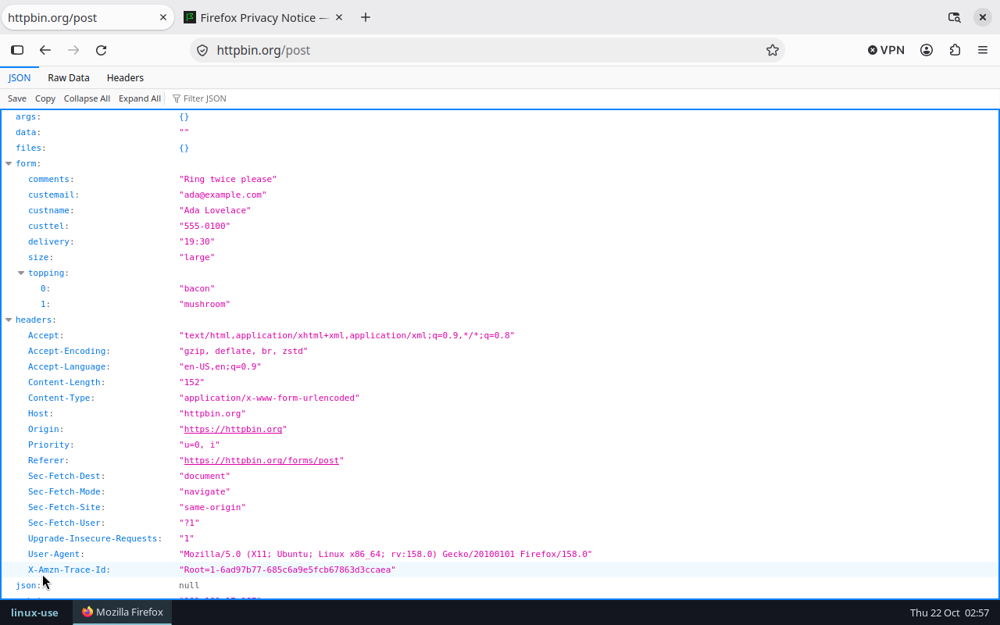

# linux-use

**Computer use for Claude Code on Linux.** Claude takes screenshots and drives the mouse, keyboard, apps, windows and clipboard of a Linux desktop, on Wayland or X11. On a server with no screen, it gets a private headless desktop with a real browser that you can watch over VNC.



Claude Code's built-in computer use is macOS-only. linux-use is a community plugin that brings the same tool surface to Linux. It's not a fork and not a patched Claude Code: it installs into your normal `claude` like any other plugin.

## Install

```text
/plugin marketplace add StivenKN/linux-use
/plugin install linux-use@linux-use
/linux-use:setup
```

`/linux-use:setup` checks your machine and offers to install anything missing. Restart Claude Code after installing so it loads the tools, then ask for something visual:

> Open Firefox, find the cheapest flight from Bogotá to Lisbon next Friday on Google Flights, and screenshot the result.

The plugin ships a small launcher. On first use it downloads one static binary (about 9 MB, amd64 or arm64), checks its SHA-256, and caches it in `~/.cache/linux-use`. There's nothing to compile and no Python or Node dependencies.

## Where Claude works

| You run Claude Code… | Claude drives… |
| --- | --- |
| in a terminal on your Linux desktop | **your desktop**. It asks for per-app access first, like the macOS version. |
| over SSH, on a server, in a container | **the agent desktop**: a private headless Wayland desktop (labwc) with a taskbar, Firefox and a terminal, started on demand. |

You can override the choice with `LINUX_USE_TARGET`: `agent` always uses the agent desktop, even inside your own (so Claude won't take over your mouse), `desktop` never starts it, and `wayland-1` or `:0` targets a specific display.

### Watching the agent desktop

The agent desktop runs a VNC server on `127.0.0.1:5900` so you can watch Claude and take over when needed (logins, CAPTCHAs):

```sh
ssh -L 5900:127.0.0.1:5900 you@server   # from your laptop
open vnc://localhost:5900                # macOS; or any VNC viewer
```

`/linux-use:desktop` starts it, stops it, or prints the address. `linux-use desktop up --window` opens it as a window inside your own desktop instead.

## Supported desktops

| Session | Screenshots | Input | Windows | Clipboard | Setup |
| --- | --- | --- | --- | --- | --- |
| **wlroots Wayland**: sway, labwc, Hyprland, river, Wayfire, niri… | screencopy / image-copy-capture | virtual pointer + keyboard | ✓ | ✓ | none |
| **Agent desktop** (labwc, headless) | ✓ | ✓ | ✓ | ✓ | `labwc wayvnc waybar swaybg foot xwayland` |
| **GNOME** (Wayland) | in progress | in progress | | | |
| **X11**: Xfce, Cinnamon, MATE, i3, GNOME/KDE on Xorg… | in progress | in progress | | | |
| **KDE Plasma** (Wayland) | planned | planned | | | |

Every Wayland protocol is spoken natively by the binary, with no `grim`, `wtype` or `ydotool` required. Typing is keyboard-layout independent: emoji, accents and CJK are typed as-is.

## Tools

linux-use mirrors the tool names, parameters and coordinate conventions of Claude Code's built-in macOS computer use. We learned them by reverse engineering Claude Code 2.1.306 with [REA](https://github.com/morluto/rea); see [`docs/research`](docs/research). Claude's experience with the official tools carries over unchanged.

`screenshot` · `zoom` · `left_click` · `double_click` · `triple_click` · `right_click` · `middle_click` · `mouse_move` · `left_click_drag` · `left_mouse_down` · `left_mouse_up` · `scroll` · `type` · `key` · `hold_key` · `cursor_position` · `open_application` · `switch_display` · `read_clipboard` · `write_clipboard` · `wait` · `computer_batch` · `request_access` · `list_granted_applications`, plus Linux extras `list_windows` and `activate_window`.

Screenshots are scaled to fit the model's image limits, and coordinates are mapped back exactly, including on HiDPI and multi-monitor setups.

## Safety

- **Your desktop:** Claude must call `request_access` with the apps it needs before it can see the screen or act. Clicks, typing and keys are refused while a non-granted app is focused (wlroots and X11 can tell which app that is). Clipboard access and system combos (alt+F4, alt+tab, lock, log out, ctrl+alt+F*) need separate grants. Claude Code's own permission prompt shows each request, so leave `request_access` un-allowlisted if you want to approve every grant. One difference from macOS: Linux compositors can't hide other apps from screenshots, so close anything private first, or use the agent desktop.
- **Agent desktop:** it's Claude's own sandbox, so everything inside it is allowed. It runs as your user, though, so apps in it can see your files. Use a separate Linux user or a VM if that matters.

## Configuration

| Variable | Default | |
| --- | --- | --- |
| `LINUX_USE_TARGET` | `auto` | `auto`, `agent`, `desktop`, `wayland-N`, `:N` |
| `LINUX_USE_RESOLUTION` | `1280x800` | agent desktop size |
| `LINUX_USE_BIN` | | run a local build instead of the release binary |

## Troubleshooting

`~/.claude/plugins/cache/linux-use/*/plugin/bin/linux-use doctor` (or `/linux-use:setup`) reports the session, the backend, a test screenshot, and the install command for anything missing. Agent desktop logs: `journalctl --user -u linux-use-desktop`.

## Development

```sh
make dev       # builds plugin/bin/linux-use-amd64, which the launcher prefers
claude --plugin-dir ./plugin
make test      # on Linux
```

- `internal/wl`: a dependency-free Wayland client (wire protocol, shm, screencopy, virtual input, toplevels, data-control, output management).
- `internal/desktop/*`: one backend per graphical stack behind a small `Backend` interface.
- `internal/session`: finds the session to drive and runs the agent desktop.
- `internal/computer`: coordinate mapping, chords, drags and app launching.
- `internal/mcpserver`: the MCP tool surface.

## License

MIT
