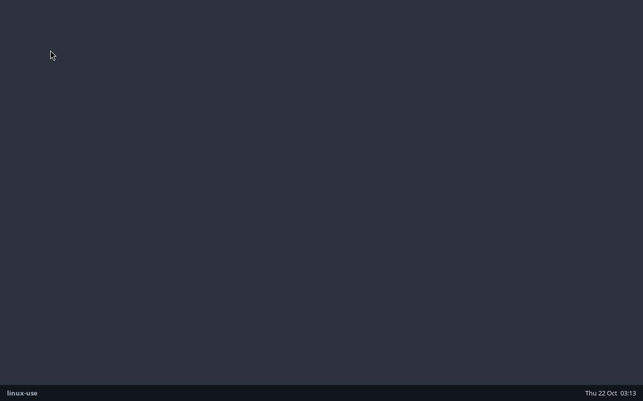

# linux-use

**Computer use for Claude Code on Linux.** Claude takes screenshots and drives the mouse, keyboard, apps, windows and clipboard of a Linux desktop, on Wayland or X11. On a server with no screen, it gets a private headless desktop with a real browser that you can watch and take over through VNC.



Claude Code's built-in computer use is macOS-only. linux-use is a community plugin that brings the same tool surface to Linux. It isn't a fork or a patched Claude Code: it installs into your normal `claude` like any other plugin.

## Install

```text
/plugin marketplace add StivenKN/linux-use
/plugin install linux-use@linux-use
/linux-use:setup
```

`/linux-use:setup` checks the machine, offers to install anything missing, and offers to stop Claude Code from asking permission on every click. Restart Claude Code so it loads the tools, then ask for something visual:

> Open Firefox, find the cheapest flight from Bogotá to Lisbon next Friday on Google Flights, and screenshot the result.

The plugin ships a small launcher. On first use, it downloads one static binary (about 9 MB, amd64 or arm64), verifies its SHA-256, and caches it in `~/.cache/linux-use`. There is nothing to compile and no Python or Node dependency.

### Permission prompts

Claude Code asks before every MCP tool call. For computer use, that means a prompt on every click. To allow the tools, add this to `~/.claude/settings.json` (setup offers to do it for you):

```json
{ "permissions": { "allow": ["mcp__plugin_linux-use_computer-use"] } }
```

## Where Claude works

| You run Claude Code… | Claude drives… |
| --- | --- |
| in a terminal on your Linux desktop | **your desktop**. It asks for per-app access first, like on macOS. |
| over SSH, on a server, or in a container | **the agent desktop**: a private headless Wayland desktop (labwc) with a taskbar, a browser and a terminal, started on demand. |
| on a desktop linux-use can't drive directly | **the agent desktop, as a window** on your screen. |

`LINUX_USE_TARGET` overrides the choice:

- `agent`: always use the headless agent desktop, even inside your own, so Claude never touches your mouse.
- `window`: the agent desktop as a window on your screen.
- `desktop`: never start the agent desktop.
- `wayland-1` or `:0`: a specific display.

### Watching the agent desktop

The agent desktop runs a VNC server, so you can watch Claude and take over for logins, 2FA or CAPTCHAs. By default it listens on a unix socket that only your user can open:

```sh
ssh -L 5900:/run/user/1000/linux-use/vnc.sock you@server   # from your laptop
open vnc://localhost:5900                                  # macOS; any VNC viewer works
```

`/linux-use:desktop` starts it, stops it, or prints the exact command. Some SSH servers refuse socket forwarding, for example Tailscale SSH when you log in as a different user. In that case, start the desktop with `--vnc-listen 127.0.0.1`, or set `LINUX_USE_VNC_LISTEN=127.0.0.1`, and use `ssh -L 5900:127.0.0.1:5900`. That viewer has no password, so only do this on machines where you trust every local user.

## Supported desktops

| Session | Screenshots | Mouse & keyboard | Windows | Clipboard | Extra setup |
| --- | --- | --- | --- | --- | --- |
| **wlroots Wayland**: sway, labwc, Hyprland, river, Wayfire, niri… | ✓ wlr-screencopy / ext-image-copy-capture | ✓ virtual pointer + keyboard | ✓ | ✓ | none |
| **X11**: Xfce, Cinnamon, MATE, i3, Openbox, GNOME/KDE on Xorg… | ✓ | ✓ XTEST | ✓ EWMH | ✓ | none |
| **GNOME (Wayland)** | ✓ screenshot portal ¹ | ✓ Mutter RemoteDesktop | ✓ with the linux-use extension ² | ✓ | GNOME Shell extension ² |
| **KDE Plasma 6 (Wayland)** | ✓ KWin ScreenShot2 | ✓ KWin fake input | ✓ | ✓ | none ³ |
| **Agent desktop** (headless labwc) | ✓ | ✓ | ✓ | ✓ | `labwc wayvnc waybar swaybg foot xwayland` |

¹ GNOME asks once ("Allow apps to take screenshots?") and remembers the answer. It flashes the screen and plays the shutter sound on every capture, which adds about half a second. While Claude is in control, GNOME shows its screen-sharing indicator. Text the keyboard layout can't type (emoji, accents, Cyrillic) is pasted, and your clipboard is restored afterwards.
² GNOME only lets its own components list windows, so linux-use ships a tiny GNOME Shell extension (GNOME 45 or newer) that lists and focuses them. `/linux-use:setup` explains it and installs it if you agree (`linux-use gnome-extension install`; `uninstall` removes it). It powers `list_windows` and `activate_window`, lets `open_application` bring a running app to the front, and shows linux-use which app is in front, so input to apps you didn't grant and typing into terminals are refused like everywhere else. GNOME only loads new extensions at login, so log out and back in once after installing. Without it, Claude works through `open_application` and screenshots, and the `request_access` grant is the only check.
³ On first use, linux-use writes a hidden `~/.local/share/applications/linux-use.desktop`. That's how KWin grants a program its screenshot and input interfaces, so there's no prompt.

The binary speaks every protocol itself, so there's no `grim`, `wtype`, `xdotool` or `ydotool` to install. Typing works with any keyboard layout, and emoji, accents and CJK are typed as-is.

## Tools

linux-use mirrors the names, parameters, result strings and coordinate conventions of Claude Code's built-in macOS computer use. We learned them by reverse engineering Claude Code 2.1.306 with [REA](https://github.com/morluto/rea) (see [`docs/research`](docs/research/claude-code-computer-use.md)), so Claude's experience with the official tools carries over unchanged.

`screenshot` · `zoom` · `left_click` · `double_click` · `triple_click` · `right_click` · `middle_click` · `mouse_move` · `left_click_drag` · `left_mouse_down` · `left_mouse_up` · `scroll` · `type` · `key` · `hold_key` · `cursor_position` · `open_application` · `switch_display` · `read_clipboard` · `write_clipboard` · `wait` · `computer_batch` · `request_access` · `list_granted_applications`, plus two Linux extras: `list_windows` and `activate_window`.

Screenshots use the same sizing as the built-in tools: the long edge is at most 1568 px and the image costs at most 1568 tokens of 28 px tiles, encoded as JPEG q75. A 1080p screen arrives as 1456×819. Coordinates map back exactly, including on HiDPI and multi-monitor setups.

## Safety

- **Your desktop:** before Claude can see the screen or act, it must call `request_access` with the apps it needs. Claude Code's permission prompt shows each request. Input is refused while an app that wasn't granted is focused. Clipboard access and system shortcuts (alt+F4, alt+tab, lock screen, log out, ctrl+alt+F1…F12) need their own grants. Linux compositors can't hide other apps from screenshots, so close anything private first, or use `LINUX_USE_TARGET=agent`.
- **Terminals and IDEs are click-only everywhere.** Claude can see them and left-click, but it can't type into them. Typing into a shell would bypass Claude Code's Bash permission rules, so shell work goes through the Bash tool.
- **Agent desktop:** it's Claude's own sandbox, so every app inside it is allowed. It still runs as your user and can reach your files. If that matters, use a separate Linux user or a VM.
- **One session at a time:** a lock stops two Claude sessions from driving the same desktop at once.

## Configuration

| Variable | Default | |
| --- | --- | --- |
| `LINUX_USE_TARGET` | `auto` | `auto`, `agent`, `window`, `desktop`, `wayland-N`, `:N` |
| `LINUX_USE_RESOLUTION` | `1280x800` | agent desktop size |
| `LINUX_USE_VNC_LISTEN` | private unix socket | TCP address for the viewer, e.g. `127.0.0.1` |
| `LINUX_USE_ALLOW_TERMINAL_INPUT` | | `1` lets Claude type into terminals and IDEs |
| `LINUX_USE_BIN` | | run a local build instead of the release binary |

## Troubleshooting

`/linux-use:setup` runs `linux-use doctor`. It reports the session, the backend, a test screenshot, and the install command for anything missing. Agent desktop logs: `journalctl --user -u linux-use-desktop`.

## Development

```sh
make dev                       # builds plugin/bin/linux-use-amd64; the launcher prefers it
claude --plugin-dir ./plugin   # try it without installing
make test                      # on Linux
```

| Package | |
| --- | --- |
| `internal/wl` | dependency-free Wayland client: wire protocol, shm, screencopy, virtual input, toplevels, data-control, output management |
| `internal/desktop/*` | one backend per graphical stack (`wlr`, `gnome`, `kde`, `x11`) behind a small `Backend` interface |
| `internal/session` | finds the session to drive and runs the agent desktop |
| `internal/computer` | coordinate mapping, screenshot sizing, chords, drags, app launching, the session lock |
| `internal/mcpserver` | the MCP tool surface, access grants and tiers |

## License

MIT
